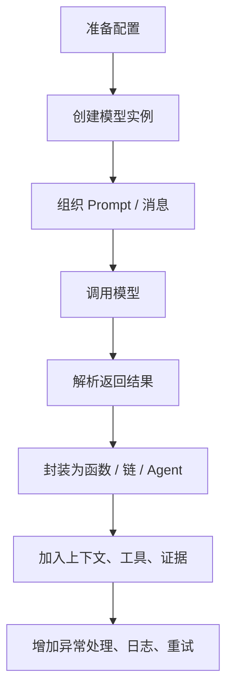

# 模型调用与 Prompt

## 1. 前言：文档定位与学习目标

本文档是一份面向大模型应用开发者的通用学习手册，主题聚焦在两个最核心的问题上：

1. 模型到底是怎么被调用的；
2. Prompt 到底应该怎么组织、怎么写、怎么在工程里管理。

这篇文档不把重点放在某一个具体项目、某一个具体厂商、某一个具体小版本的 API 细节上，而是优先讲清楚一条更稳定的主线：

- 如何理解模型调用；
- 如何从最小示例一步步走到工程化写法；
- Prompt 有哪些常见组织方式；
- 每种写法分别适合什么场景；
- 在 RAG、Agent、对话系统里，Prompt 会发生什么变化；
- 工程里如何做异常处理、复用、调试和维护。

为了避免后续学习时被“版本细节”卡住，本文档采用 **LangChain v1 系列通用写法** 作为讲解主线。也就是说，文档中的多数示例和思路可覆盖 `LangChain 1.0 ~ 1.2` 这一段常用写法。当前项目实际运行环境也是 v1 系列，因此你既可以把这篇文档当作通用学习材料，也可以在最后一章把它和项目源码对照起来看。

### 学完本文档后，你应该能做到

1. 能独立写出最小可运行的模型调用代码；
2. 理解 `SystemMessage`、`HumanMessage`、`PromptTemplate`、`ChatPromptTemplate` 的区别；
3. 能根据场景选择合适的 Prompt 组织方式；
4. 能写出基础的 RAG Prompt、工具型 Agent Prompt、结构化输出 Prompt；
5. 能理解模型调用链路中的几个关键环节：配置、创建模型、组织消息、调用、解析结果、异常处理；
6. 后续再看项目里的 Agent、RAG、知识库、任务流代码时，不会只看到“功能”，而是能看懂“模型调用是如何落地的”。

---

## 2. 什么是模型调用，什么是 Prompt

### 2.1 什么是模型调用

模型调用，本质上就是把一段输入交给大模型，再把模型返回的结果取回来。

从工程角度看，一次完整的模型调用通常包含这些动作：

1. 准备模型配置；
2. 创建模型实例；
3. 组织输入消息；
4. 调用模型；
5. 解析输出；
6. 必要时做异常处理、日志记录和结果格式化。

所以，“模型调用”不只是写一行 `model.invoke(...)`，它背后通常还包括配置管理、Prompt 组织、上下文注入、重试策略、错误处理等配套环节。

### 2.2 什么是 Prompt

Prompt 可以简单理解为：**你给模型的输入指令与上下文**。

很多初学者会把 Prompt 理解成“给模型的一句话”，这只对了一部分。在真实工程里，Prompt 往往由多部分组成：

- 系统角色：告诉模型“你是谁、你应该怎么回答”；
- 用户输入：用户真正的问题；
- 上下文：对话历史、业务规则、知识库证据、联网检索证据等；
- 输出约束：格式要求、字数限制、语言风格、是否需要引用来源；
- 安全约束：不要编造、证据不足时必须说明、优先基于已知材料回答等。

所以更准确地说：

> Prompt 不是一句话，而是一套“让模型按预期工作”的输入组织方式。

### 2.3 为什么工程里不能只写一个字符串

因为随着场景复杂度上升，单字符串写法会很快出现这些问题：

1. 不好复用：不同场景都在复制粘贴；
2. 不好维护：规则一多就变成长字符串，难读、难改；
3. 不好调试：很难看出系统要求、用户输入、证据片段分别是什么；
4. 不好扩展：一旦要加历史消息、RAG 证据、工具规则，就会越来越乱；
5. 不利于团队协作：别人看代码时难以理解 Prompt 的结构和意图。

所以从学习角度看，最重要的不是“能不能写一句 Prompt”，而是：

> 你能不能把 Prompt 组织成一种清晰、可复用、可扩展、可调试的工程结构。

---

## 3. 通用模型调用主链

这一章是全文最重要的主线。你可以把它理解成“大模型应用中最小又完整的一条链路”。



下面我们把这条链拆开。

### 3.1 第一步：准备模型配置

模型调用一定先有配置。最常见的配置包括：

- 模型提供商；
- 模型名称；
- API Key；
- Base URL；
- 超时时间；
- 温度；
- 最大输出长度。

最小示例：

```python
MODEL_CONFIG = {
    "provider": "qwen",
    "model_name": "qwen-plus",
    "api_key": "your_api_key",
    "base_url": "https://dashscope.aliyuncs.com/compatible-mode/v1",
    "temperature": 0.5,
    "timeout": 30,
}
```

#### 优点

- 最容易理解模型调用需要哪些输入；
- 适合最小 demo 和初学练习；
- 便于后面演化成配置文件。

#### 缺点

- 仍然是手工字典；
- 不适合多环境；
- 不适合多人协作。

### 3.2 第二步：创建模型实例

配置只是静态数据，真正能发请求的是模型实例对象。

最小示例：

```python
from langchain_openai import ChatOpenAI

model = ChatOpenAI(
    model=MODEL_CONFIG["model_name"],
    api_key=MODEL_CONFIG["api_key"],
    base_url=MODEL_CONFIG["base_url"],
    temperature=MODEL_CONFIG["temperature"],
    timeout=MODEL_CONFIG["timeout"],
)
```

这里有一个很重要的认知：

> `ChatOpenAI` 这个名字不代表你只能接 OpenAI。

在很多兼容 OpenAI 风格接口的模型服务里，也可以通过同一套客户端调用。比如 Qwen、DeepSeek、一些兼容 OpenAI Chat Completions 接口的模型网关，往往都可以通过这种方式接入。

### 3.3 第三步：组织 Prompt / 消息

这一步就是把“你想让模型知道的内容”组织成结构化输入。

最小消息示例：

```python
from langchain_core.messages import SystemMessage, HumanMessage

messages = [
    SystemMessage(content="你是一个中文技术助手，请回答简洁清楚。"),
    HumanMessage(content="请解释一下什么是 Prompt。"),
]
```

这就是最常见、最基础的消息式 Prompt 组织方式。

### 3.4 第四步：发起模型调用

```python
response = model.invoke(messages)
print(response.content)
```

从学习角度看，`invoke()` 是最值得先掌握的调用入口。因为它足够直接，能让你把注意力放在：

- 输入是什么；
- 输出是什么；
- Prompt 是怎么影响结果的。

### 3.5 第五步：解析模型返回结果

工程里不要默认返回值永远是理想状态。通常要做一个兼容性兜底。

```python
answer = response.content if isinstance(response.content, str) else str(response.content)
print(answer)
```

### 3.6 第六步：封装为函数

一旦逻辑稳定，就应该把模型调用封装起来，避免业务代码到处复制。

```python
from langchain_core.messages import SystemMessage, HumanMessage

def ask_model(model, question: str) -> str:
    messages = [
        SystemMessage(content="你是一个中文助手。"),
        HumanMessage(content=question),
    ]
    response = model.invoke(messages)
    return response.content if isinstance(response.content, str) else str(response.content)
```

### 3.7 第七步：逐渐加入上下文、证据、工具

初始版本只传一个问题。真实项目里，后面会慢慢加上：

- 多轮历史消息；
- 检索证据；
- 知识库片段；
- 工具规则；
- 输出格式要求；
- 结构化 schema；
- 安全限制。

这就是为什么大模型应用从“一个函数”逐渐演化成：

- Prompt 模板；
- Runnable 链；
- RAG；
- Agent；
- 工作流。

---

## 4. 最小模型调用示例：直接调用模型

这一章只做一件事：让你用最短代码跑通模型调用。

### 4.1 纯消息调用

```python
from langchain_openai import ChatOpenAI
from langchain_core.messages import SystemMessage, HumanMessage

model = ChatOpenAI(
    model="qwen-plus",
    api_key="your_api_key",
    base_url="https://dashscope.aliyuncs.com/compatible-mode/v1",
    temperature=0.5,
    timeout=30,
)

response = model.invoke([
    SystemMessage(content="你是一个中文技术助手。"),
    HumanMessage(content="请解释什么是 Agent。")
])

print(response.content)
```

### 4.2 这种写法适合什么场景

- 学习模型调用的第一步；
- 最小 demo；
- 单轮问答；
- 验证模型能否正常连通；
- 做 Prompt 小实验。

### 4.3 优点

- 上手最快；
- 代码量最少；
- 输入输出最直观；
- 适合快速调 Prompt。

### 4.4 缺点

- Prompt 很容易散落在代码里；
- 一旦场景变多，维护成本会上升；
- 不适合复杂上下文、多轮对话、RAG 和 Agent。

---

## 5. Prompt 的常见组织方式

这一章是全文的核心之一。你后面在不同项目里看到的 Prompt 写法，基本都可以归到这几类。

### 5.1 写法一：纯字符串 Prompt

```python
prompt = "你是一个中文助手，请解释什么是大模型。"
```

#### 适合场景

- 极简 demo；
- 临时实验；
- 只做最小验证。

#### 优点

- 最简单；
- 最快；
- 适合临时测试。

#### 缺点

- 工程化最弱；
- 角色、输入、规则混在一起；
- 复用性和可维护性都很差。

### 5.2 写法二：`SystemMessage + HumanMessage`

```python
from langchain_core.messages import SystemMessage, HumanMessage

messages = [
    SystemMessage(content="你是一个中文老师。"),
    HumanMessage(content="请解释什么是 RAG。"),
]
```

#### 适合场景

- 单轮问答；
- 入门学习；
- 多轮对话的基础形态；
- 工程里最常见的基础写法。

#### 优点

- 角色清晰；
- 结构自然；
- 容易和对话历史结合；
- 和 Agent、Memory、RAG 都兼容。

#### 缺点

- 多个场景共享时容易重复；
- 变量较多时，字符串拼接会越来越多。

### 5.3 写法三：`PromptTemplate`

适合“单段模板化文本”，尤其适合摘要、改写、分类、抽取等单输入任务。

```python
from langchain.prompts import PromptTemplate

summary_prompt = PromptTemplate(
    template="请将下面内容总结成不超过{word_limit}字：\n{text}",
    input_variables=["text", "word_limit"],
)

rendered = summary_prompt.format(
    text="这里是一大段待总结的文本内容。",
    word_limit=80,
)

print(rendered)
```

#### 适合场景

- 文本总结；
- 改写；
- 分类；
- 信息抽取；
- 单次任务型调用。

#### 优点

- 参数化清楚；
- 复用方便；
- 对“单段任务”很友好。

#### 缺点

- 不如消息式 Prompt 适合对话场景；
- 不适合复杂多角色消息结构。

### 5.4 写法四：`ChatPromptTemplate`

适合聊天、多轮对话、上下文组合、系统角色与用户输入分离的场景。

```python
from langchain.prompts import ChatPromptTemplate

prompt = ChatPromptTemplate.from_messages([
    ("system", "你是一个中文技术助理。"),
    ("human", "请解释：{topic}")
])

messages = prompt.format_messages(topic="什么是 Prompt 工程")
response = model.invoke(messages)
print(response.content)
```

#### 适合场景

- 聊天机器人；
- 多轮对话；
- 带上下文的问答；
- 后续要扩展工具、RAG、记忆时。

#### 优点

- 结构最自然；
- 最适合对话模型；
- 易于扩展历史消息与额外上下文。

#### 缺点

- 比最小写法多了一层模板；
- 对初学者来说比直接写消息列表稍抽象。

### 5.5 写法五：带历史占位的 Prompt

```python
from langchain.prompts import ChatPromptTemplate, MessagesPlaceholder

prompt = ChatPromptTemplate.from_messages([
    ("system", "你是一个多轮对话助手。"),
    MessagesPlaceholder(variable_name="history"),
    ("human", "{question}")
])

messages = prompt.format_messages(
    history=[],
    question="请解释什么是向量检索"
)
```

#### 适合场景

- 多轮聊天；
- 记忆系统；
- 会话型助手。

#### 优点

- 扩展多轮对话非常自然；
- 历史消息和当前输入边界清楚。

#### 缺点

- 历史过长会带来上下文膨胀问题；
- 需要配合摘要、截断或记忆机制。

### 5.6 写法六：结构化输出 Prompt

如果你不想只要一段自然语言，而是希望模型返回结构化结果，可以使用结构化输出。

```python
from pydantic import BaseModel, Field
from langchain_openai import ChatOpenAI

class UserIntent(BaseModel):
    category: str = Field(description="问题类别")
    need_search: bool = Field(description="是否需要联网搜索")
    reason: str = Field(description="判断原因")

model = ChatOpenAI(
    model="gpt-4o-mini",
    api_key="your_api_key",
)

structured_model = model.with_structured_output(UserIntent)

result = structured_model.invoke("请判断：'浙江科技大学官网是什么' 是否需要联网搜索")
print(result)
```

#### 适合场景

- 分类；
- 路由；
- 字段抽取；
- 结构化任务结果。

#### 优点

- 输出更稳定；
- 便于后续程序处理；
- 非常适合路由与流程控制。

#### 缺点

- 对模型支持能力有要求；
- schema 设计不好时也会导致结果不稳定。

---

## 6. 多轮对话中的 Prompt 写法

多轮对话和单轮问答最大的区别，不是模型不同，而是输入结构不同。

单轮问答通常只关心：

- 系统角色；
- 当前问题。

多轮对话还必须考虑：

- 历史消息如何保留；
- 哪些历史消息真正有用；
- 上下文是否过长；
- 系统角色是否会被历史消息“稀释”。

### 6.1 最简单的多轮示例

```python
from langchain_core.messages import SystemMessage, HumanMessage, AIMessage

messages = [
    SystemMessage(content="你是一个中文助手。"),
    HumanMessage(content="什么是 Agent？"),
    AIMessage(content="Agent 是能够根据目标执行步骤的智能系统。"),
    HumanMessage(content="那它和普通问答有什么区别？"),
]

response = model.invoke(messages)
print(response.content)
```

### 6.2 模板化多轮示例

```python
from langchain.prompts import ChatPromptTemplate, MessagesPlaceholder

prompt = ChatPromptTemplate.from_messages([
    ("system", "你是一个教学型助手，解释尽量清楚、分步骤。"),
    MessagesPlaceholder(variable_name="history"),
    ("human", "{question}")
])

history = [
    ("human", "什么是 Prompt？"),
    ("ai", "Prompt 是给模型的输入指令与上下文。"),
]

messages = prompt.format_messages(
    history=history,
    question="那 PromptTemplate 是什么？"
)

response = model.invoke(messages)
print(response.content)
```

### 6.3 多轮写法的优点

- 能保持上下文连续性；
- 适合聊天、教学、助手类产品；
- 更接近真实用户使用场景。

### 6.4 多轮写法的缺点

- 上下文会越来越长；
- 无关历史会干扰当前回答；
- 如果没有做摘要和裁剪，成本和延迟都会增加。

---

## 7. RAG 场景中的 Prompt 写法

RAG 的核心不是“搜到了东西”，而是：

> 你如何把检索结果组织成模型真正能用的 Prompt。

所以，RAG 学习的重点之一就是“证据如何进入 Prompt”。

### 7.1 最基础的证据增强 Prompt

```python
question = "什么是 RAG？"
evidence = """
[来源1] RAG 是 Retrieval-Augmented Generation，即检索增强生成。
[来源2] 它通常先检索外部知识，再把检索结果交给模型生成答案。
"""

messages = [
    SystemMessage(content="你是一个基于证据回答问题的助手。证据不足时必须明确说明。"),
    HumanMessage(content=f"问题：{question}\n\n证据：\n{evidence}\n\n请基于证据回答。")
]

response = model.invoke(messages)
print(response.content)
```

### 7.2 更规范的 RAG Prompt

```python
system_prompt = """
你是一个知识问答助手。
请严格基于提供的证据回答问题。
如果证据不足，请明确说明“证据不足”。
不要编造未出现在证据中的事实。
关键结论后尽量标注来源编号。
""".strip()

user_prompt = f"""
用户问题：
{question}

证据如下：
{evidence}

请输出最终答案。
""".strip()
```

### 7.3 RAG Prompt 的关键设计点

1. 明确告诉模型“必须基于证据回答”；
2. 明确证据不足时的行为；
3. 明确是否需要引用来源；
4. 控制证据格式，让模型更容易读；
5. 先做证据筛选，再拼 Prompt，不要什么都塞进去。

### 7.4 优点

- 回答更可控；
- 更容易减少幻觉；
- 适合知识库问答、联网问答、事实查询。

### 7.5 缺点

- Prompt 更长；
- 对证据质量依赖高；
- 检索排序不佳时，回答质量也会受影响。

---

## 8. Agent 场景中的 Prompt 写法

当任务不再只是“回答问题”，而是需要：

- 选择工具；
- 调用工具；
- 读工具结果；
- 再继续思考；

这时更适合使用 Agent 风格调用。

### 8.1 最小工具型 Agent 示例

```python
from langchain.agents import create_agent

def get_weather(city: str) -> str:
    return f"{city} 今天晴，25 度。"

agent = create_agent(
    model=model,
    system_prompt="你是一个天气助手。优先通过工具获取天气，不要凭空猜测。",
    tools=[get_weather],
)

result = agent.invoke({
    "messages": [{"role": "user", "content": "帮我查一下杭州天气"}]
})

print(result)
```

### 8.2 Agent Prompt 和普通 Prompt 的区别

普通 Prompt 更强调：

- 你怎么回答。

Agent Prompt 更强调：

- 你在什么情况下要用工具；
- 工具结果出来后你应该怎么处理；
- 遇到信息不足时你应该怎么决策。

### 8.3 Agent Prompt 的常见规则

一个好的 Agent 系统 Prompt，常见会写这些内容：

1. 角色定位；
2. 可用工具说明；
3. 什么情况下必须用工具；
4. 什么情况下不能编造；
5. 默认输出语言；
6. 输出格式约束。

示例：

```python
system_prompt = """
你是一个任务型智能体助手。
可用工具如下：
- get_weather：查询天气
- get_user_location：获取用户位置

规则：
1. 如果用户问天气但没有给地点，先获取用户位置；
2. 如果工具能提供信息，优先用工具，不要凭空编造；
3. 默认使用中文回答；
4. 回答尽量简洁清楚。
""".strip()
```

### 8.4 优点

- 适合复杂任务；
- 易于接工具；
- 可扩展成更完整的工作流。

### 8.5 缺点

- 调试难度更高；
- 新手不容易第一眼看懂执行过程；
- Prompt 只是 Agent 的一部分，还要理解工具和状态流。

---

## 9. 模型调用的工程化封装

真正的项目不会把模型调用全部散落在业务函数里。通常会逐步抽象出这些层：

1. 配置层；
2. 模型工厂层；
3. Prompt 模板层；
4. 场景函数层；
5. Agent / RAG / Workflow 层；
6. 路由与 API 层。

### 9.1 模型工厂封装示例

```python
from langchain_openai import ChatOpenAI

def create_model(provider: str, model_name: str, api_key: str, base_url: str | None = None):
    return ChatOpenAI(
        model=model_name,
        api_key=api_key,
        base_url=base_url,
        temperature=0.5,
        timeout=30,
    )
```

#### 优点

- 模型切换集中管理；
- Provider 差异更容易收口；
- 便于前后端传参统一。

#### 缺点

- 多了一层抽象；
- 初期 demo 看起来没有直接写来得快。

### 9.2 Prompt 函数封装示例

```python
def build_rag_prompt(question: str, evidence_text: str):
    system_prompt = (
        "你是一个基于证据回答问题的助手。"
        "如果证据不足，请明确说明。"
    )
    user_prompt = f"问题：{question}\n\n证据：\n{evidence_text}\n\n请作答。"
    return system_prompt, user_prompt
```

### 9.3 为什么工程里要做这一层

因为这样做能把“模型调用”和“业务逻辑”分开：

- 业务层关注“我要回答什么问题”；
- Prompt 层关注“我要怎么组织输入”；
- 模型工厂关注“我要调用哪个模型”。

这三层一旦分开，项目就会清晰很多。

---

## 10. 多种写法的优缺点对比

下面这张表是本文最适合反复查阅的部分之一。

| 写法 | 典型形式 | 适合场景 | 优点 | 缺点 |
|---|---|---|---|---|
| 纯字符串 Prompt | `"你是一个助手..."` | 最小 demo | 最简单、最快 | 不规范、不易维护 |
| 消息列表 | `SystemMessage + HumanMessage` | 单轮问答、基础聊天 | 清晰自然、最适合入门 | 复杂场景容易手工拼接过多 |
| `PromptTemplate` | `.format(...)` | 摘要、分类、改写、抽取 | 参数化明确、复用好 | 不够适合多轮对话 |
| `ChatPromptTemplate` | `.from_messages(...)` | 聊天、多角色、多轮上下文 | 结构最自然、工程常用 | 学习门槛略高 |
| 结构化输出 | `with_structured_output(...)` | 路由、分类、字段抽取 | 输出稳定、便于程序处理 | 依赖模型能力与 schema 设计 |
| RAG Prompt | `问题 + 证据` | 知识库问答、联网问答 | 更可控、能减少幻觉 | Prompt 长、依赖检索质量 |
| Agent Prompt | `create_agent(..., system_prompt=...)` | 工具调用、多步任务 | 可扩展、适合复杂任务 | 调试成本更高 |

如果你是刚开始学，推荐优先级是：

1. 消息列表；
2. `PromptTemplate`；
3. `ChatPromptTemplate`；
4. RAG Prompt；
5. Agent Prompt；
6. 结构化输出。

---

## 11. 常见错误与排查

### 11.1 模型连通了，但回答总是不符合预期

常见原因：

1. 系统角色不清楚；
2. 用户输入不够具体；
3. 没有写清楚输出要求；
4. Prompt 同时塞了太多规则，模型抓不到重点。

建议排查顺序：

1. 先简化 Prompt；
2. 再确认系统提示是否清楚；
3. 再补格式要求；
4. 最后再加复杂上下文。

### 11.2 RAG 场景明明有证据，但回答仍然很差

常见原因：

1. 检索结果不相关；
2. 证据片段太长、太杂；
3. Prompt 没强调“必须基于证据”；
4. 证据排序不合理；
5. 引用格式混乱，模型读不清。

建议：

1. 先减少证据数量；
2. 优先保留最相关片段；
3. 用统一格式组织证据；
4. 加上“证据不足时明确说明”的规则。

### 11.3 多轮对话越来越乱

常见原因：

1. 历史消息无限增长；
2. 旧问题持续干扰新问题；
3. 没有做摘要；
4. 系统 Prompt 被淹没在长上下文里。

建议：

1. 控制历史长度；
2. 对长上下文做摘要；
3. 区分“短期上下文”和“长期记忆”；
4. 保持系统角色稳定。

### 11.4 同一个 Prompt，换模型效果差异很大

这是正常现象。常见原因包括：

1. 模型能力不同；
2. 输出偏好不同；
3. 对长上下文的稳定性不同；
4. 结构化输出能力不同；
5. 对工具调用、JSON、引用格式的遵守程度不同。

所以工程里不要只问：

> “这个 Prompt 好不好？”

还要问：

> “这个 Prompt 对哪个模型更合适？”

### 11.5 结构化输出老是失败

常见原因：

1. schema 过于复杂；
2. 字段描述不清楚；
3. 模型本身结构化支持有限；
4. 你同时要求“自然语言长回答”和“严格结构化”，目标冲突。

建议：

1. 先从简单 schema 开始；
2. 每个字段写清描述；
3. 让结构化输出承担“程序输入”，自然语言回答承担“用户展示”；
4. 不要什么都塞在一个结果里。

---

## 12. 项目中的落地示例

前面讲的是通用方法。如果你想回到当前项目里对照学习，可以重点看下面这些文件。

### 12.1 模型配置入口

[dependencies.py](/D:/demodemo/py-demo/agent-demo/rag_demo/src/app/core/dependencies.py)

你可以在这里看到：

- 模型 provider 配置；
- API Key / Base URL / 默认模型；
- 统一的 `Settings` 配置对象。

### 12.2 模型工厂

[model_factory.py](/D:/demodemo/py-demo/agent-demo/rag_demo/src/app/agents/common/model_factory.py)

这是当前项目里最值得重点看的文件之一。你可以重点读：

- `resolve_provider(...)`
- `get_model_unavailable_reason(...)`
- `create_model(...)`

这个文件对应本文第 3 章和第 9 章的内容。

### 12.3 最简单的工具型 Agent Prompt

[weather/agent.py](/D:/demodemo/py-demo/agent-demo/rag_demo/src/app/agents/weather/agent.py)

你可以在这里看到：

- 系统 Prompt 怎么写；
- `create_agent(...)` 怎么用；
- 工具如何接入；
- 结构化输出如何配置。

### 12.4 最直接的模型调用示例

[planner_router/agent.py](/D:/demodemo/py-demo/agent-demo/rag_demo/src/app/agents/planner_router/agent.py)

重点看：

- `_direct_answer(...)`

这里最适合学习“直接 `model.invoke([...])`”的写法。

### 12.5 知识库问答中的 Prompt 组织

[kb_qa/agent.py](/D:/demodemo/py-demo/agent-demo/rag_demo/src/app/agents/kb_qa/agent.py)

重点看：

- 检索结果如何整理成 `evidence_blocks`
- `system_prompt`
- `user_prompt`
- 最终 `model.invoke(...)`

### 12.6 联网 RAG 中的 Prompt 链

[web_qa/agent.py](/D:/demodemo/py-demo/agent-demo/rag_demo/src/app/agents/web_qa/agent.py)

这是当前项目中 Prompt 最复杂的一段链路，值得重点看：

1. 检索查询改写 Prompt；
2. 二次重试查询 Prompt；
3. 非联网直接回答 Prompt；
4. 最终证据融合 Prompt。

这个文件很适合帮助你理解：

> 一个完整的大模型应用，往往不是只有“一个 Prompt”，而是一串 Prompt 共同完成任务。

---

## 13. 学习路线与下一步建议

如果你对这一块还不熟，建议按下面顺序学。

### 第一阶段：先学最小调用

目标：

- 先搞清楚模型到底怎么调；
- 理解消息输入和模型输出。

建议练习：

1. 用 `ChatOpenAI` 建立模型实例；
2. 用 `SystemMessage + HumanMessage` 调一次；
3. 打印 `response.content`。

### 第二阶段：学 Prompt 模板

目标：

- 从“能调用”走向“能规范写 Prompt”。

建议练习：

1. 写一个 `PromptTemplate` 做摘要；
2. 写一个 `ChatPromptTemplate` 做问答；
3. 对比两者适用场景。

### 第三阶段：学多轮对话

目标：

- 理解历史消息怎么进入 Prompt；
- 理解为什么上下文会膨胀。

建议练习：

1. 自己手工写一段 `history`；
2. 用 `MessagesPlaceholder` 注入历史；
3. 对比单轮与多轮效果。

### 第四阶段：学 RAG Prompt

目标：

- 理解“证据怎么进入模型”。

建议练习：

1. 手工写一段 `evidence_text`；
2. 把它和用户问题一起拼进 Prompt；
3. 测试“有证据”和“无证据”时回答风格有何不同。

### 第五阶段：学 Agent Prompt

目标：

- 理解工具型任务和普通问答的区别。

建议练习：

1. 写一个最简单的工具函数；
2. 用 `create_agent(...)` 接进去；
3. 观察 Agent 如何根据问题决定是否调用工具。

### 第六阶段：学工程化

目标：

- 从示例代码走向真实项目结构。

建议练习：

1. 做配置层；
2. 做模型工厂；
3. 做 Prompt 组织函数；
4. 做异常处理与日志；
5. 再回到项目源码对照学习。

---

## 14. 本文档的使用建议

这篇文档最适合这样用：

1. 第一次阅读时，从第 3 章开始，先建立通用主链；
2. 然后读第 4、5、6 章，把基本写法掌握；
3. 再读第 7、8 章，理解 RAG 和 Agent 的 Prompt 变化；
4. 遇到具体工程问题时，回来看第 9、10、11 章；
5. 最后配合第 12 章，对照当前项目源码深入学习。

如果你只想先掌握最关键的内容，请优先读这四章：

1. 第 3 章：通用模型调用主链；
2. 第 5 章：Prompt 的常见组织方式；
3. 第 7 章：RAG 场景中的 Prompt 写法；
4. 第 10 章：多种写法的优缺点对比。

---

## 15. 小结

模型调用与 Prompt，看起来只是“大模型应用里的一个小环节”，但实际上它们是整个系统最基础、最核心的能力。

你后面学：

- RAG；
- 知识库；
- Agent；
- 多 Agent；
- 任务编排；
- 评测；

几乎都绕不开这两个问题：

1. 你到底怎么把输入交给模型；
2. 你到底怎么把 Prompt 组织得足够清楚、足够稳定、足够可维护。

所以如果你能真正掌握本文这条主线，后续再看更复杂的 AI 系统时，就不会只看到“功能很多”，而是能看清它们背后共同的骨架。

